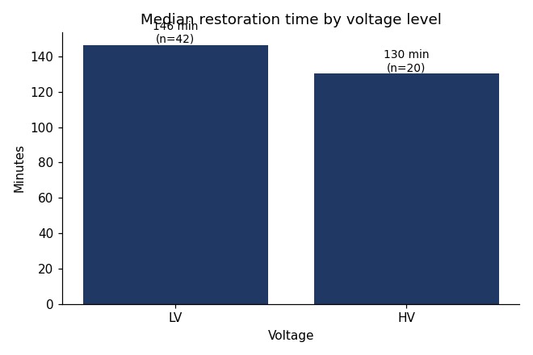
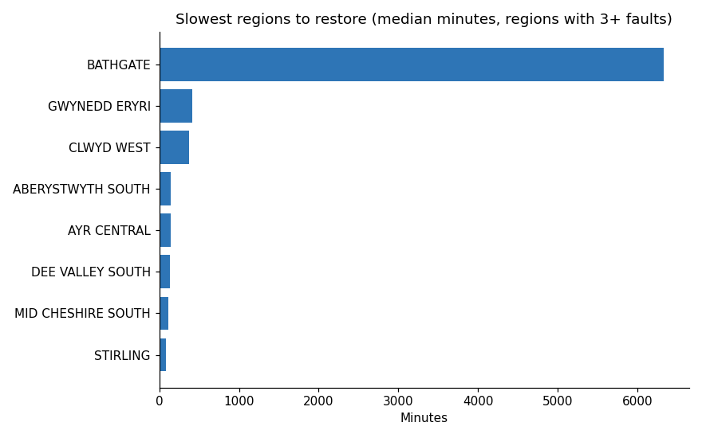
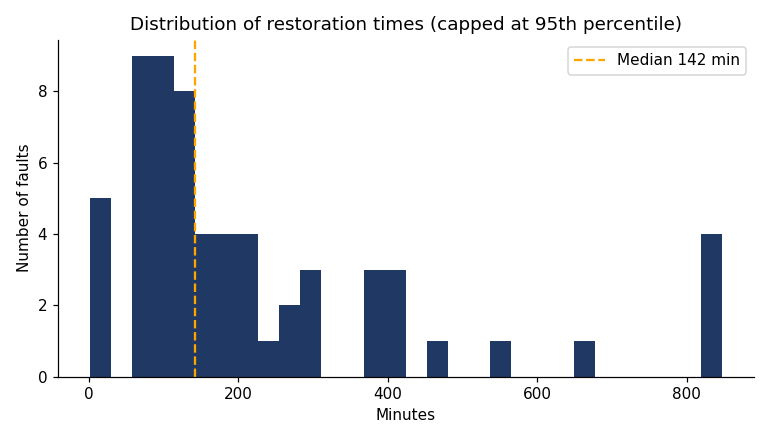
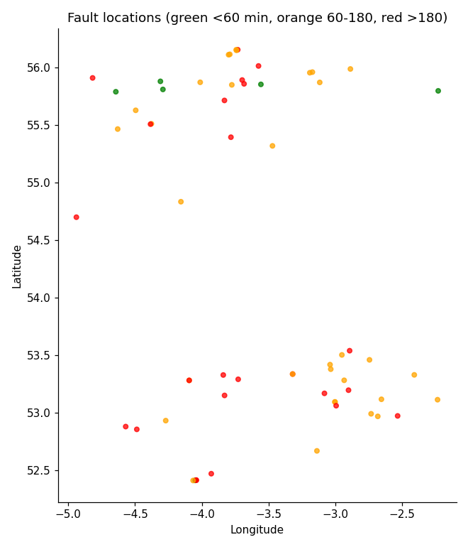

# Network Fault Restoration Analysis (SP Energy Networks open data)

## Question
Where and how quickly are faults restored across SP Manweb and SP Distribution, and how accurate are the estimated restoration times?

*Why it matters:* Faster restoration reduces customer minutes lost and helps the network operator target resources

## Data
- Source: SP Energy Networks Open Data Portal, National Energy Outage (NEO) Data: https://spenergynetworks.opendatasoft.com/explore/assets/national-energy-outage-data/
- Licence: [copy from the dataset's Information tab]
- 2 daily export(s) combined; 62 completed, unplanned faults analysed, reported between 29 Sep 2026 and 19 Oct 2026.

## Method
1. Combined daily exports and kept the latest record per Fault ID.
2. Cleaning (rows remaining after each step):

| Step                        |   Rows remaining |
|:----------------------------|-----------------:|
| Raw rows across all exports |               79 |
| Unique faults (by Fault ID) |               77 |
| Status = Completed/Restored |               67 |
| Unplanned only              |               63 |
| Has restoration time        |               63 |
| Restoration >= 1 min        |               62 |
| Coordinates inside UK       |               62 |

3. Calculated restoration time (minutes) and estimate error (actual minus estimated restoration).
4. Compared medians by voltage, licence area and region.
5. Mapped faults with Folium and grouped locations into hotspots with K-Means (Scikit-learn).

## Key findings (review and reword in your own words)
- Overall median restoration time was 142 minutes across 62 faults. By voltage: LV 146 min (n=42), HV 130 min (n=20).
- Among regions with at least 3 faults, BATHGATE was slowest (median 6330 min) and STIRLING fastest (85 min).
- 7% of 57 faults with an estimate were restored later than estimated (median error -80 min).
- The largest hotspot contains 20 faults, mostly in MID CHESHIRE SOUTH, with a median restoration time of 138 minutes.

## Outputs





Interactive maps: `outputs/fault_map.html` and `outputs/cluster_map.html` (open in a browser).

## Limitations
- Data coverd 17-22 oct 2026
- Short time window from a live feed, so this is a snapshot, not a long-term trend.
- No cause-of-fault field, so I can't explain why some faults take longer.
- Clusters use location only and are indicative.

## How to run
```
pip install -r requirements.txt
python run_project.py "<dataset page URL>"
```
